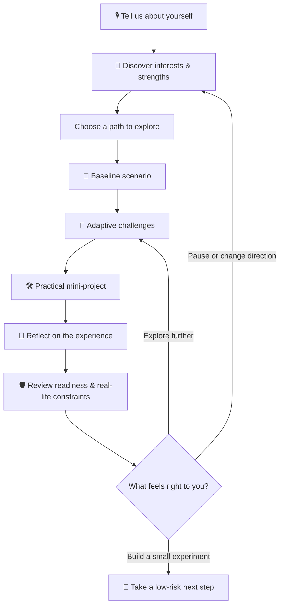

<div align="center">


### Your next chapter should begin with possibility, not pressure.

**NayaPath** is a voice-first livelihood discovery experience that helps people explore new careers, small-business ideas and additional income opportunities—while respecting the work, responsibilities and strengths they already have.

[Explore the repository](https://github.com/Titiksha-P/NayaPath) · [Report an issue](https://github.com/Titiksha-P/NayaPath/issues)


</div>

---

## 🌱 The idea behind NayaPath

A person can be good at their current work and still dream about something different. A shop owner might be curious about digital services. A student might want to discover a skill they have never tried. A working parent might want an additional income stream without risking the household's stability.

But taking a new direction can feel like a leap into the unknown.

**NayaPath turns that leap into a series of smaller, safer discoveries.**

Instead of simply telling someone *“you should become a designer”* or *“start a business”*, NayaPath is being built to help them:

- discover possibilities they may not have considered;
- recognise the strengths and transferable skills they already have;
- try realistic challenges before making a major commitment;
- learn at a pace that fits their actual life;
- understand the financial realities of exploring a new direction; and
- decide for themselves what the next step should be.

> **Our principle: Explore before you transition.**
>
> You do not have to quit your current work to begin discovering what else is possible.

## ✨ What can someone explore?

<table>
<tr>
<td width="50%">

### 🧭 A different career
Explore a new field, experience realistic tasks and build evidence of skills before making a move.

</td>
<td width="50%">

### 🪴 A business of their own
Start with a customer problem, test a small idea and understand the costs before investing.

</td>
</tr>
<tr>
<td>

### 💡 Additional income
Explore supplementary work that can fit around an existing occupation and responsibilities.

</td>
<td>

### 🎨 A new interest
Try something unfamiliar, reflect on the experience and discover what feels worth pursuing.

</td>
</tr>
</table>

## 🎙️ Designed around people's voices

Voice should be more than a microphone icon beside a form. It should make the experience feel natural and approachable.

NayaPath's discovery flow includes browser-based speech input where supported, alongside ordinary typing and touch controls. The discovery screen now offers a language selector for all 22 languages listed in the Eighth Schedule of the Indian Constitution, plus English, and passes the selected locale to the browser Speech Recognition API. Actual recognition support and quality vary by browser, operating system and language; unsupported locales must fall back to typing. The interface copy is currently English, so this is not yet a fully translated 22-language experience. Translation, native-speaker review and device-by-device speech testing remain required.

We want the experience to grow towards multilingual, conversational guidance—with clear consent, visible transcription and a reliable text alternative.

## 🧠 Learn by trying: the adaptive assessment

A fixed 30-day plan cannot reflect everyone's circumstances. People have different starting points, available time, responsibilities and learning curves.

NayaPath's assessment prototype explores a different approach: **the next challenge should respond to evidence of learning, not to a countdown.**

### The experience

1. **Start with a baseline.** Try a realistic scenario in the path you want to explore.
2. **Work through challenges.** Scenarios move across foundation, developing, applied and stretch levels.
3. **Notice how you learn.** The prototype records attempts, correctness, hints and response time.
4. **Apply the idea.** A practical mini-project asks you to take a decision beyond a multiple-choice question.
5. **Reflect.** Record what felt interesting, difficult or surprisingly natural.
6. **Choose what happens next.** The intended journey can adapt as skills, interests and circumstances become clearer.

### What the prototype currently measures

| Signal | Why it matters |
|---|---|
| Attempts and correctness | Shows how a person is approaching a challenge |
| Hints used | Helps understand what kind of support is useful |
| Response time | Adds context; it is **not** treated as a measure of intelligence or potential |
| Practical application | Looks for evidence beyond quiz answers |
| Interest and reflection | Keeps the person's own experience in the decision |

The challenge-selection engine uses recent performance and hint-dependence signals to select an appropriate next level. It does not advance someone merely because time has passed.

**A note on retention:** the engine has a retention evidence field, but a real spaced-recall workflow is still to be built. Until that exists, the prototype does not claim to measure long-term retention.

This is a learning and exploration prototype—not a validated psychometric instrument, diagnosis, hiring test or guarantee of career suitability.

## 🧭 Universal Livelihood Intelligence Engine

The discovery flow now uses a shared, extensible opportunity catalogue rather than branching into a separate recommendation script for a few named occupations.

A profile is assembled from the person's circumstances—current work and informal experience, goals, working hours, commute, days off, energy, contract status, skills, device access, location and exploration budget. The engine then:

1. asks targeted follow-up questions when important information is missing;
2. generates candidates across primary-income improvement, supplementary income, independent livelihood and capability development;
3. applies hard feasibility checks for long hours, low energy, missing rest, limited digital access and contract restrictions;
4. ranks remaining candidates using transparent relevance and feasibility signals; and
5. explains the checks and a low-risk next step for each candidate.

The starter catalogue is deliberately occupation-agnostic and can be extended with new opportunity records. Occupation and skills are used as relevance signals, not as a fixed destiny or a reason to exclude someone from exploring another field. Contract-sensitive outside work is held when approval is required or restrictions may apply. Unknown working hours do not count as spare time; unknown contract terms do not count as permission.

**Important boundary:** the catalogue currently contains illustrative opportunity patterns, not live vacancies or verified local demand. It does not generate earnings estimates, guarantee eligibility, provide legal clearance or establish that a business will succeed. Local opportunity data, provider verification, broader accessibility review and native-language research are still required before real-world deployment.

Automated tests include synthetic profiles across varied occupations and constraint combinations. These tests check engine invariants; they are not evidence that the catalogue covers every person's circumstances or that real-world recommendations are validated.

## 🇮🇳 Verified Indian livelihood resource directory

The discovery results can surface a curated set of official, India-wide portals with source attribution, evidence notes, verification date, audience tags and explicit safety caveats. Resources currently include:

- **National Career Service (NCS):** government job search, career centres, job fairs and counselling. NCS states that registration, applications and interview processing are free.
- **Skill India Digital Hub:** skill courses, skill centres, job exchange, sectors and job roles.
- **Kisan Sarathi:** region-specific agriculture advisories and access to agricultural experts / KVK channels.
- **e-NAM:** the National Agriculture Market and farmer-facing trading information.
- **Udyam Registration:** official MSME registration information; the Ministry portal states registration is free and warns against unauthorised intermediaries.
- **Farmers’ Portal:** government directory of farmer-facing services and scheme resources.

Each resource is labelled as an India-wide directory or information portal. The user's city is not used to fabricate local vacancies. Local matching still requires checking the relevant district, participating centre/mandi, current batch, employer, eligibility and terms on the official destination. No portal card implies a live opening, subsidy approval, income estimate or guaranteed outcome.

A location-aware referral is included for the **Delhi Employment Exchange**, which publishes vacancy-notification and skilled/semi-skilled short-duration hiring sections. It is shown only when the user enters Delhi as their location. The portal reported OTP-service disruption on 27 November 2026, so users are warned to check current service status. This is a link to the official portal, not an extracted vacancy list. For other locations, NayaPath currently uses India-wide official directories rather than inventing state or district listings.

The source catalogue records a manual verification date and evidence summary. It is not an automated freshness monitor; links and programme details must be rechecked before each real-world referral. The UI includes a source-and-safety disclosure on every card.

## 🛡️ A future should fit real life—and real finances

Exploring a new livelihood should not put someone's existing stability at risk.

A responsible readiness review needs to understand more than a person's ambition. It should eventually consider:

- income, including seasonal or irregular income;
- essential household expenses and debt payments;
- accessible savings and emergency reserves;
- dependants and existing responsibilities;
- the cost and time required to explore a path;
- risk comfort and the ability to absorb a setback; and
- most importantly, whether the person actually wants to proceed.

**Unknown does not mean zero.** Missing financial information must remain unknown—not be treated as proof that a person can afford a transition.

The current review is deliberately conservative. Financial values captured in discovery are not yet securely connected to the assessment engine, so it does not make a transition recommendation. NayaPath does not tell people to quit, borrow money or spend emergency savings.

## 🗺️ How the journey fits together



There is no universal deadline in this journey. A person can pause, revisit an idea or explore another direction.

## 🧪 Try the prototype

### Run it locally

**Requirements:** Node.js 20 or later and npm.

```bash
git clone https://github.com/Titiksha-P/NayaPath.git
cd NayaPath
npm install
npm run dev
```

Open the local URL printed by Vite (usually `http://localhost:5173`).

### Run with Docker

```bash
docker compose up --build
```

Then open [http://localhost:4173](http://localhost:4173).

### Available scripts

| Command | Purpose |
|---|---|
| `npm run dev` | Start the local development server |
| `npm run build` | Type-check and create a production build |
| `npm run preview` | Preview the production build locally |
| `npm test` | Run the assessment-engine tests |

## 🧰 Under the hood

NayaPath is being developed as a lightweight web application with a deliberately small initial footprint.

- **React 18 + TypeScript** — interactive user experience and typed application logic.
- **Vite** — local development and production bundling.
- **Lucide React** — interface iconography.
- **Vitest** — assessment-engine unit tests.
- **Docker + Nginx** — containerised static deployment.
- **Web Speech API** — browser-dependent speech input with typed fallback.
- **Local storage** — prototype progress persistence in the user's browser.
- **PWA shell** — manifest and service-worker foundation.

### Project map

```text
NayaPath/
├── public/
│   └── sw.js
├── docs/
│   └── assets/
│       └── nayapath-banner.svg
├── src/
│   ├── App.tsx
│   ├── AdaptiveAssessment.tsx
│   ├── assessmentEngine.ts
│   ├── assessmentEngine.test.ts
│   ├── assessment.css
│   ├── style.css
│   ├── main.tsx
│   └── registerSW.ts
├── Dockerfile
├── docker-compose.yml
├── nginx.conf
├── package.json
└── README.md
```

## 🚧 Where the project is today

NayaPath is an **active prototype**, and we want to be transparent about what is implemented and what still needs work.

| Area | Current state |
|---|---|
| Responsive discovery experience | Prototype implemented |
| Language selection | 22 Eighth Schedule languages plus English; browser locale request, support varies |
| Adaptive challenge selection | Initial evidence-based engine implemented |
| Attempts, hints and response time | Captured in the assessment |
| Practical mini-project and reflection | Prototype implemented |
| Long-term retention | Spaced-recall workflow not yet implemented |
| Financial readiness | Conservative review; financial integration incomplete |
| Accounts and cloud sync | Not implemented; progress is browser-local |
| Curated local opportunities | Needs sourced content and provenance |
| Full multilingual interface and verified speech quality | Future development; translations and testing not yet complete |

The project still needs a verified production build, broader automated and accessibility testing, more diverse livelihood scenarios, secure financial-data handling and independent evaluation for fairness and reliability. The challenge bank is illustrative and should not be used to make real employment or financial decisions.

## 🛤️ What's next?

We are working towards a more complete experience with:

- richer, occupation-specific simulations and practical tasks;
- spaced-recall checks to understand what a person remembers over time;
- a genuinely adaptive learning journey with pause, resume and direction changes;
- a secure and transparent financial-readiness workflow;
- more Indian languages and tested voice experiences;
- trustworthy learning resources and local opportunity discovery; and
- privacy, accessibility, safety and bias evaluation before real-world deployment.

## 💚 The belief

A person's current occupation does not define the limits of their future.

NayaPath is being built around a simple belief: **people deserve the space to discover, experiment and grow—without being pushed into a risky leap.**

*One small experiment can open up a whole new direction.*

---

<div align="center">

**NayaPath — A new path. A future of your own.**

Made with curiosity, care and the belief that everyone deserves room to grow. 🌱

</div>

## 🎙️ Live multilingual voice conversation (Sarvam)

NayaPath's voice onboarding is designed as a continuous, voice-only conversation. The user does not choose a language or fill a form first: the microphone opens, Sarvam Saaras v4 detects the spoken language, and NayaPath responds one turn at a time.

- `/api/voice.ts` — authenticated server-side WebSocket proxy to Sarvam's Saaras v4 realtime streaming endpoint. The long-lived API key stays on the server.
- `/api/voice-turn.ts` — translates the utterance to English for conversation reasoning, calls Sarvam-105B Conversations, translates the reply back, extracts explicitly stated profile fields, and generates spoken audio where Bulbul supports the language.
- The browser streams mono 16 kHz LINEAR16 PCM in short frames. Interim transcripts appear while the user speaks; VAD detects the end of each turn.
- The UI shows the original-language transcript and its English meaning. The assistant replies aloud and then resumes listening automatically.
- The conversation starts by asking whether the person can read and write or mainly speaks, then adapts its questions to the details already shared. It must not ask the user to type.

### Configure Sarvam

Set `SARVAM_API_KEY` as a **Secret** in Vercel Project → Settings → Environment Variables for Production, then redeploy. For local development, copy `.env.example` to `.env` and keep that file out of Git.

### Language coverage and limitations

Saaras v4 realtime STT and Sarvam Translate support all 22 scheduled Indian languages plus English. Bulbul v3 TTS supports 10 Indian languages plus English; for other languages the client attempts the device's installed speech voice. Device voice availability varies, so spoken replies are not yet guaranteed on every device for every language. This integration still needs real-device testing for microphone permissions, audio quality, latency, translation quality and profile extraction before it should be described as production-validated.
